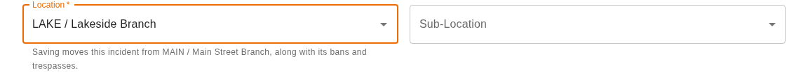
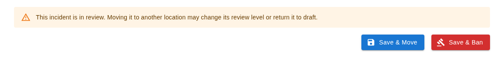
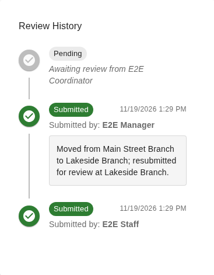

# Moving an Incident to Another Location

An incident can be moved to a different location after it's created,
for example when it was filed under the wrong branch. The move happens
from the incident's **Edit** page and takes the incident's bans and
trespasses with it.

## Who can move an incident

You need permission to edit incidents at **both** the current location
and the new one. If the incident has bans or trespasses, you also need
permission to edit bans at both locations.

Incidents in review can only be edited by their reviewers, so moving an
incident that's waiting for review is usually done by a reviewer.

## How to move an incident

1. Open the incident and choose **Edit**.
2. Pick the new location in the **Location** field. The field is
   highlighted, and the note under it names the location the incident
   is moving from.

   

3. The save button changes to **Save & Move**. If the incident is in
   review, a warning above the button says its review may change (see
   below).

   

4. Choose **Save & Move**. A message confirms the move and what
   happened to the incident's review.

   

Any other changes you made on the Edit page are saved at the same time.

## What happens to the review

Review chains belong to locations, so a move can't keep an incident's
place in the old location's chain. What happens depends on where the
incident was in review:

| Before the move | After the move |
|-----------------|----------------|
| Draft, or returned to the reporter | Unchanged: still a draft at the new location |
| Waiting for review | Resubmitted at **level 1** of the new location's chain |
| Waiting for review, and the new location has no review chain | Returned to draft; submit it again once a chain exists |
| Resolved | Stays resolved; only a final reviewer at the new location can move it |

A resubmitted incident shows the move in its **Review History**, and the
level 1 reviewers at the new location are notified as for any new
submission.

Administrators can change the second row so that moved incidents always
return to draft instead; the reporter then resubmits them at the new
location. This is the site setting `incident.move.review_mode`
(`first_level`, the default, or `return_to_draft`).

## Bans and trespasses

Bans and trespasses created on the incident move with it to the new
location. Bans that this incident only **extended** belong to the
incident that created them and stay where they are.

Ban and trespass letters name the location that issued them, so after
the move you're offered the chance to generate new letters for any
active bans. You can skip this and do it later: edit the ban and choose
**Save & Regenerate Letter**.

## Things that don't move

- **Follow-up and related incidents** keep their own locations; only the
  incident you edit moves.
- **Sub-location** is cleared unless you pick one at the new location.
  Follow-up incidents never have a sub-location.
